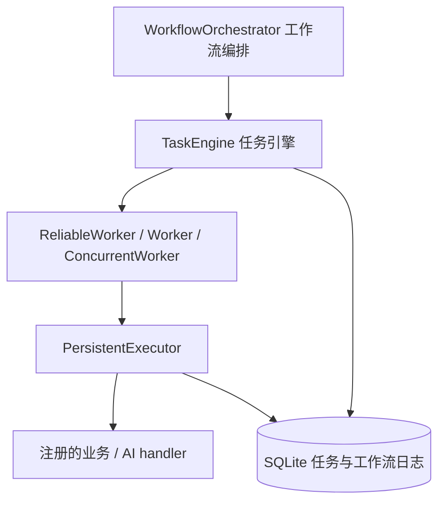

# DAG 工作流编排

## 架构



`WorkflowOrchestrator` 通过 TaskEngine 的公开接口提交、观察和推进工作流，以及
创建 worker。编排模块不调用业务函数、不直接驱动执行器、不访问任务引擎的私有
字段。TaskEngine 将存储操作委托给 `SQLiteWorkflowStore`，将任务执行交给既有
worker；执行器继续负责任务重试、超时、执行所有权和事件记录。

当前 DAG API 要求配置持久化 TaskEngine，无需新增第三方依赖。

## 定义与输入输出

`DAGWorkflow(nodes=(...), id=..., name=...)` 描述一次工作流运行；同一工作流
需要再次执行时使用新的 ID。`DAGNode` 使用唯一节点 ID、注册函数名 `handler`、
静态 `args` / `kwargs` 和 `depends_on` 依赖。`inputs` 将关键字参数绑定到
`OutputRef(node_id, path)`；引用自动产生依赖边，无需重复声明。

`path=()` 传递完整结果；例如 `('documents', 0, 'text')` 读取字典字段和列表
第一个元素。路径中的列表索引必须非负，缺失字段、越界索引或不匹配的数据类型
使该节点进入 FAILED，实际执行次数保持 0，其后代进入 SKIPPED。
绑定不能覆盖静态 kwargs，参数调用签名错误则按普通任务失败与重试处理。

定义通过 Kahn 算法验证，拒绝空图、重复节点、未知依赖、自依赖与环。
拓扑计算复杂度为 O(V+E)。节点配置复用 Task 的优先级、重试、超时、到期时间
和幂等参数约束。参数、输出必须是严格 JSON 数据，静态位置参数外层使用元组。
提交时保存经过验证的 JSON 快照，之后修改调用方字典不会改变已提交的图。
可以通过 `to_dict()` / `from_dict()` 保存、加载工作流定义。

```python
from workflow_engine import (
    DAGNode, DAGWorkflow, OutputRef, RetryPolicy, TaskEngine, WorkflowOrchestrator,
)

def retrieve(query):
    return {'documents': [{'text': f'资料：{query}'}]}

def model(context, model_name):
    # 在真实部署中，这里调用应用已有的模型客户端。
    return {'answer': f'{model_name}: {context}', 'usage': {'tokens': 10}}

def validate(answer):
    if not answer:
        raise ValueError('模型输出为空')
    return {'answer': answer, 'valid': True}

engine = TaskEngine(
    database_path='workflow.db',
    task_registry={'retrieve': retrieve, 'model': model, 'validate': validate},
    retry_policy=RetryPolicy(2, initial_delay=0.1),
    max_workers=3,
)
orchestrator = WorkflowOrchestrator(engine)
workflow = DAGWorkflow(nodes=(
    DAGNode('retrieve', 'retrieve', kwargs={'query': 'DAG 工作流'}),
    DAGNode('model', 'model', kwargs={'model_name': 'my-model'}, timeout=30,
            inputs={'context': OutputRef('retrieve', ('documents', 0, 'text'))}),
    DAGNode('validate', 'validate', inputs={'answer': OutputRef('model', ('answer',))}),
))
orchestrator.submit(workflow)
result = orchestrator.run(workflow.id, timeout=60)
print(result.status, result.nodes['validate'].result)
```

AI 集成是模型、检索、工具调用与输出校验的注册函数组合。可以并行调用不同
模型再汇合结果，每个节点分别配置重试和超时。平台不持有模型供应商凭据，
也不执行模型返回的任意代码；应用自行注册工具函数和模型客户端适配器。
集成测试使用确定性的适配器，验证平台传递和保存 AI 结构化结果的能力。

## 依赖调度与运行

节点状态为 WAITING、READY、RUNNING、RETRYING、SUCCESS、FAILED、SKIPPED。
仅当全部前驱 SUCCESS 时放行节点；失败后的 RETRYING 仍然阻塞下游。
重试耗尽或不可恢复失败只跳过其后代，其余独立分支继续执行。
全部节点终结后，全部 SUCCESS 的工作流为 SUCCESS，否则为 FAILED。

`run(id)` 通过 TaskEngine 创建 `max_workers` 个注册消费者，循环推进依赖，
结束时优雅停止这些消费者。worker 从共享任务数据库领取任务，因此可能同时
处理同一数据库的其他已就绪任务；工作流并发数不是整个数据库的全局并发限制。
`run(id, execute=False)` 只负责推进与等待，供其他进程的 worker 执行任务。

生产部署也可以独立运行控制面，每隔一段时间调用 `tick()`，推进所有非终态
工作流；`tick(id)` 只推进指定工作流，返回运行快照列表。多个编排进程可安全
重复推进同一工作流，不会重复放行或覆盖已绑定参数。
`get(id)` 返回快照，未知工作流返回 None；工作流总状态以最近一次 tick 为准，
节点快照同时反映当前任务状态。`run` 返回前总会完成状态汇总。

原有 `TaskEngine.start()` 是一次性的内存队列消费入口，不负责持续推进 DAG。
DAG 请使用 `run()`，或 `tick()` 配合持续运行的注册 worker。
`pending_count` 只计算可领取的待执行任务，不包含尚未满足依赖或已跳过的节点。

`run(timeout=...)` 的超时限制控制面等待时间，不强杀正在执行的业务调用。
本地 worker 优雅退出会等待这些调用收尾，所以方法返回时间可能超过该时间。
需要无人值守长时间运行时，应单独部署控制面和 worker，并让应用为外部请求
设置客户端超时。

## 持久化与恢复边界

- `workflow_runs` 保存不可变定义与聚合状态，`workflow_nodes` 保存节点与任务
  的对应关系、节点状态和依赖/绑定错误。节点任务 ID 由工作流 ID 与节点 ID
  确定性生成。整张图、全部任务和初始任务事件在一次事务中提交；任意节点
  注册或序列化失败会回滚整个提交。
- 工作流重复提交相同 ID 和相同定义会返回当前运行，不重复执行；相同 ID
  使用不同定义会抛出 `IdempotencyConflict`。
- 每个未就绪任务持有 `workflow_blocked` 调度门。输出绑定写入任务定义和
  打开门发生在同一事务中。数据库领取接口同时检查该门，持续 worker、
  普通任务入口或陈旧本地队列都不能绕过依赖执行下游。
- 普通 worker 提交的 SUCCESS/FAILED/RETRYING 结果仍与任务事件、重试预算
  原子写入。编排进程即使在结果提交后、放行前退出，新进程 tick 仍能放行；
  放行后、执行前退出，就绪任务也能被新 worker 领取。
- 重新连接相同数据库、使用相同 registry 名称后调用 tick/run 即可恢复
  编排。仅编排进程退出时无需恢复或接管仍活跃的 worker。
- 业务执行中断继续遵守原有恢复规则：确认所有旧普通 worker 已退出后才能
  使用 `recover_interrupted=True`；注册 worker 需使用已有的怀疑、隔离、
  确认停止与 `recover_worker(session_id)` 流程。不会因编排重启或心跳超时
  自动重放任务。只有显式 `idempotent=True` 且仍有已持久化重试预算的节点
  才能重放，其余节点失败并阻塞后代。业务幂等必须由稳定业务键实现；仅设置
  该布尔字段不提供外部副作用的 exactly-once 保证。

旧数据库自动新增调度门字段，默认 0；既有独立任务保持原来的可领取行为。

## 独立集成测试

使用真实磁盘 SQLite、真实注册 worker、线程同步以及 `os._exit(23)` 子进程
故障注入。每个文件可独立执行：

```powershell
$env:PYTHONPATH = 'src'
python -m unittest discover -s tests -p test_dag_scheduling_integration.py
python -m unittest discover -s tests -p test_dag_recovery_integration.py
python -m unittest discover -s tests -p test_dag_ai_integration.py
python -m unittest discover -s tests -p test_dag.py
```

分别验证并行分支与汇合、多编排器幂等推进、跨进程 worker 协作、下游领取隔离、重试等待与失败传播；
事务回滚、并发重复提交、结果提交/放行两处崩溃边界、幂等恢复、不安全任务隔离与注册 worker 分阶段恢复；
检索→模型→工具→校验的 AI 流程及无效输出路径；以及图定义的校验和序列化。
